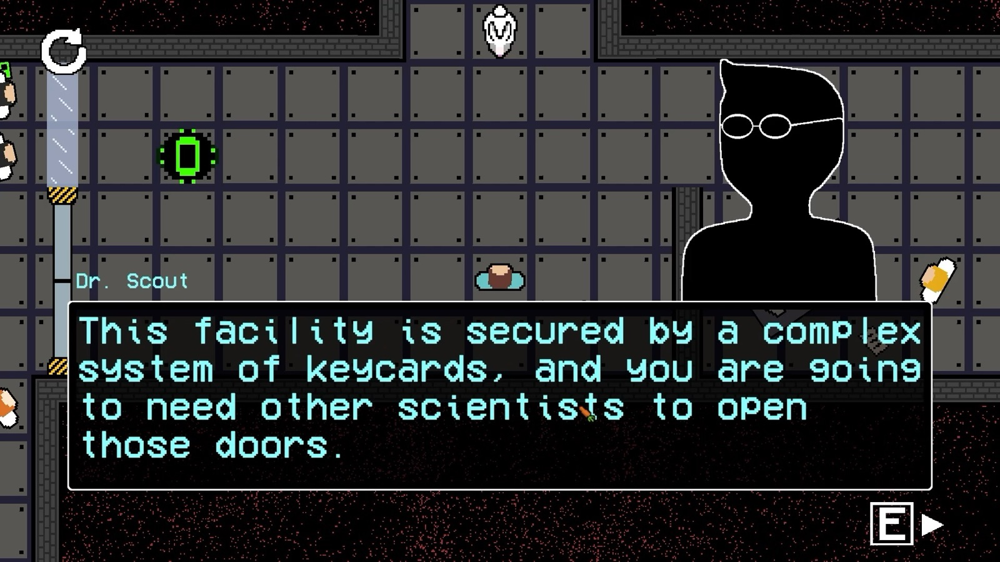

# Zach van Ryn — Game Portfolio

Computer science student making games.

### 🎮 [zachvanryn.github.io](https://zachvanryn.github.io)

---

## Eagle's Nest

A top-down 2D puzzle game about escaping a research facility locked down with keycards.

Made in **Unity (C#)** for CTIN 489: Intermediate Game Design and Production at the University of Southern California, 2026, with William Pile.

**[Download for Mac / Windows](https://github.com/zachvanryn/eagles-nest/releases/latest)** ·
**[Watch the gameplay video](https://youtu.be/RLEsmRcc8JQ)**

---

## Contact

[GitHub](https://github.com/zachvanryn) · [LinkedIn](https://www.linkedin.com/in/zachary-van-ryn-899846249/)

Built from scratch with HTML, CSS and JavaScript, hosted on GitHub Pages.
